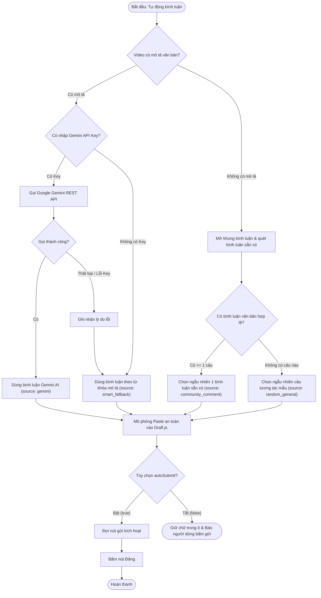

# Data Model & State Transitions: Cấu hình, Bình luận & Kết nối AI

## 1. Entities & Storage Schema

### Stored Settings Entity (`chrome.storage.local`)

| Thuộc tính | Kiểu dữ liệu | Giá trị mặc định | Mô tả |
| :--- | :--- | :--- | :--- |
| `likeMethod` | `string` (`"auto"` \| `"button"` \| `"key_l"` \| `"double_click"`) | `"auto"` | Phương thức thực hiện thả tim video TikTok |
| `geminiApiKey` | `string` | `""` | Khóa API Google Gemini của người dùng |
| `commentStyle` | `string` (`"friendly"` \| `"compliment"` \| `"humorous"` \| `"question"`) | `"friendly"` | Tông giọng/phong cách bình luận muốn tạo |
| `autoSubmit` | `boolean` | `true` | Tự động bấm nút gửi sau khi điền nội dung vào ô |

---

### Video Metadata Entity (`GET_ACTIVE_VIDEO_INFO` Response)

| Thuộc tính | Kiểu dữ liệu | Bắt buộc | Mô tả |
| :--- | :--- | :--- | :--- |
| `success` | `boolean` | Có | Trạng thái trích xuất thành công |
| `hasDescription`| `boolean` | Có | `true` nếu video có caption văn bản > 2 ký tự |
| `description` | `string` | Có | Nội dung mô tả (đã loại hashtag) |
| `rawDescription`| `string` | Có | Chuỗi mô tả đầy đủ ban đầu |
| `hashtags` | `string[]` | Có | Danh sách hashtag gắn trên video |
| `existingComments`| `string[]` | Có | Danh sách các bình luận văn bản trích xuất được từ video |
| `canComment` | `boolean` | Có | `true` nếu tính năng bình luận không bị khóa |

---

### Comment Generation Result Entity

| Thuộc tính | Kiểu dữ liệu | Giá trị có thể có | Mô tả |
| :--- | :--- | :--- | :--- |
| `success` | `boolean` | `true` \| `false` | Trạng thái tạo câu bình luận |
| `text` | `string` | Nội dung câu bình luận | Câu bình luận sẵn sàng để điền vào TikTok |
| `source` | `string` | `"gemini"` \| `"community_comment"` \| `"smart_fallback"` \| `"random_general"` | Nguồn gốc câu bình luận |
| `errorReason` | `string` \| `null` | Chuỗi mô tả lỗi (nếu có) | Chi tiết lỗi nếu gọi AI thất bại |

---

## 2. State Transition: Quy trình phân giải nguồn bình luận (Comment Resolution Flow)

