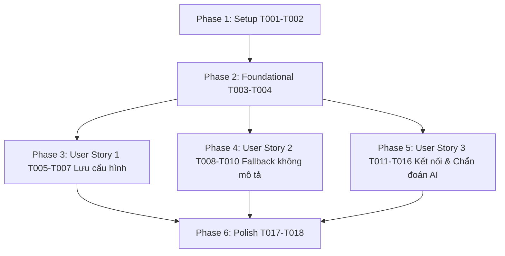

# Tasks: Lưu cấu hình, xử lý bình luận dự phòng thông minh và tối ưu kết nối AI

**Input**: Design documents from `/specs/003-description-comment-fallback-persistence/` (`spec.md`, `plan.md`, `research.md`, `data-model.md`, `contracts/messaging.md`, `quickstart.md`)

**Prerequisites**: plan.md (required), spec.md (required for user stories), research.md, data-model.md, contracts/

**Tests**: Kiểm thử thủ công theo các kịch bản định nghĩa tại [quickstart.md](./quickstart.md).

**Organization**: Tasks are grouped by user story to enable independent implementation and testing of each story.

## Format: `[TaskID] [P?] [Story?] Description with file path`

- **[P]**: Có thể thực hiện song song (khác tệp tin, không phụ thuộc vào task chưa hoàn thành)
- **[Story]**: Đánh dấu thuộc User Story nào ([US1], [US2], [US3])
- Luôn kèm đường dẫn tệp tin chính xác trong mô tả task

---

## Phase 1: Setup & Environment

**Purpose**: Đồng bộ phiên bản và chuẩn bị cấu trúc tệp tin

- [X] T001 Cập nhật phiên bản tiện ích lên `1.3.0` trong [manifest.json](file:///d:/Code/extensions/auto-interaction-tiktok/manifest.json)
- [X] T002 Đồng bộ hằng số phiên bản `SCRIPT_VERSION = "1.3.0"` trong [content/content.js](file:///d:/Code/extensions/auto-interaction-tiktok/content/content.js) và [sidepanel/sidepanel.js](file:///d:/Code/extensions/auto-interaction-tiktok/sidepanel/sidepanel.js)

---

## Phase 2: Foundational (Blocking Prerequisites)

**Purpose**: Mở rộng kho bình luận mẫu ngẫu nhiên và các hằng số dùng chung cho cả User Story 2 và User Story 3

- [X] T003 [P] Bổ sung kho bình luận tương tác ngẫu nhiên tổng quát `GENERAL_FALLBACK_POOL` (15+ câu tiếng Việt tự nhiên) và hàm `getRandomGeneralComment()` trong [sidepanel/ai-generator.js](file:///d:/Code/extensions/auto-interaction-tiktok/sidepanel/ai-generator.js)
- [X] T004 [P] Định nghĩa các hằng số định danh nguồn bình luận (`SOURCE_GEMINI`, `SOURCE_COMMUNITY`, `SOURCE_FALLBACK`, `SOURCE_GENERAL`) và bảng nhãn hiển thị trong [sidepanel/sidepanel.js](file:///d:/Code/extensions/auto-interaction-tiktok/sidepanel/sidepanel.js)

**Checkpoint**: Nền tảng dữ liệu đã sẵn sàng - có thể tiến hành triển khai các User Story.

---

## Phase 3: User Story 1 - Tự động lưu và khôi phục toàn bộ tùy chọn cấu hình trên Side Panel (Priority: P1) 🎯 MVP

**Goal**: Lưu bền vững toàn bộ 4 tùy chọn (`likeMethod`, `geminiApiKey`, `commentStyle`, `autoSubmit`) vào `chrome.storage.local`, tự động cập nhật khi thay đổi và khôi phục 100% khi mở Side Panel.

**Independent Test**: Thay đổi phương thức thả tim sang "Phím L", nhập API Key, chọn phong cách "Hài hước", bỏ chọn "Tự động gửi", đóng và mở lại Side Panel để xác nhận toàn bộ giá trị vẫn giữ nguyên.

### Implementation for User Story 1

- [X] T005 [US1] Cập nhật hàm `loadSettings()` trong [sidepanel/sidepanel.js](file:///d:/Code/extensions/auto-interaction-tiktok/sidepanel/sidepanel.js) để đọc và khôi phục đủ 4 trường `likeMethod`, `geminiApiKey`, `commentStyle`, `autoSubmit` với giá trị mặc định chuẩn
- [X] T006 [US1] Cập nhật hàm `saveSettings()` trong [sidepanel/sidepanel.js](file:///d:/Code/extensions/auto-interaction-tiktok/sidepanel/sidepanel.js) để lưu đồng bộ cả 4 trường vào `chrome.storage.local` kèm phản hồi giao diện nút bấm
- [X] T007 [US1] Gắn bộ lắng nghe sự kiện `change` tự động lưu (auto-save) trên `methodSelect`, `styleSelect`, `autoSubmitCheck`, và sự kiện `input`/`change` trên `apiKeyInput` trong [sidepanel/sidepanel.js](file:///d:/Code/extensions/auto-interaction-tiktok/sidepanel/sidepanel.js)

**Checkpoint**: Hoàn tất User Story 1. Tùy chọn của người dùng được bảo toàn vĩnh viễn qua mọi phiên làm việc.

---

## Phase 4: User Story 2 - Trích xuất bình luận sẵn có & dự phòng ngẫu nhiên khi video không có mô tả (Priority: P1)

**Goal**: Khi video không có caption, tự động mở khung bình luận, trích xuất danh sách bình luận văn bản sẵn có (`[data-e2e^="comment-level"]`) và chọn ngẫu nhiên 1 câu hợp lệ; nếu video chưa có bình luận, tự động dùng câu tương tác từ kho ngẫu nhiên đa dạng.

**Independent Test**: Mở video không có caption nhưng có bình luận, bấm "Tự động bình luận" xác nhận tiện ích lấy được một bình luận sẵn có để tương tác. Thử trên video không caption và 0 bình luận, xác nhận chọn được câu ngẫu nhiên từ kho chung.

### Implementation for User Story 2

- [X] T008 [US2] Bổ sung hàm `extractExistingComments()` trong [content/content.js](file:///d:/Code/extensions/auto-interaction-tiktok/content/content.js) để tìm kiếm các thẻ `[data-e2e^="comment-level"]`, làm sạch văn bản, loại bỏ icon/emoji thuần túy và chuỗi quá ngắn (< 3 ký tự)
- [X] T009 [US2] Nâng cấp hàm `extractVideoDescription()` và message handler `GET_ACTIVE_VIDEO_INFO` trong [content/content.js](file:///d:/Code/extensions/auto-interaction-tiktok/content/content.js) để trả về cờ `hasDescription: boolean` và mảng `existingComments: string[]` theo đúng hợp đồng [messaging.md](./contracts/messaging.md)
- [X] T010 [US2] Cập nhật logic điều phối `handleStartComment()` trong [sidepanel/sidepanel.js](file:///d:/Code/extensions/auto-interaction-tiktok/sidepanel/sidepanel.js): Nếu `!videoInfo.hasDescription`, ưu tiên chọn ngẫu nhiên 1 câu từ `videoInfo.existingComments` (gán source `community_comment`); nếu danh sách rỗng, gọi `getRandomGeneralComment()` (gán source `random_general`)

**Checkpoint**: Hoàn tất User Story 2. 100% video TikTok không có caption đều được tạo bình luận tự nhiên và phù hợp.

---

## Phase 5: User Story 3 - Chẩn đoán, tối ưu và hiển thị minh bạch kết quả tạo bình luận từ AI (Priority: P1)

**Goal**: Hỗ trợ endpoint đa model (`gemini-1.5-flash` và fallback `gemini-2.0-flash`), bắt và báo lỗi cụ thể (sai key, hết hạn quota, lỗi mạng), thêm nút "Kiểm tra Key" trên UI và hiển thị huy hiệu nguồn gốc câu bình luận rõ ràng.

**Independent Test**: Bấm "Kiểm tra Key" với key hợp lệ và key không hợp lệ, xác nhận Side Panel phản hồi chính xác trạng thái. Bấm bình luận và xác nhận huy hiệu xem trước hiển thị đúng loại nguồn (`✨ Gemini AI`, `💬 Từ video`, `💡 Thông minh`, `🎲 Ngẫu nhiên`).

### Implementation for User Story 3

- [X] T011 [P] [US3] Bổ sung nút "Kiểm tra Key" (`btnTestApiKey`) và khối thông báo kết quả kiểm tra (`apiKeyStatus`) vào giao diện cài đặt AI trong [sidepanel/sidepanel.html](file:///d:/Code/extensions/auto-interaction-tiktok/sidepanel/sidepanel.html)
- [X] T012 [P] [US3] Bổ sung kiểu dáng CSS cho nút "Kiểm tra Key" và các trạng thái thành công/thất bại của API Key trong [sidepanel/sidepanel.css](file:///d:/Code/extensions/auto-interaction-tiktok/sidepanel/sidepanel.css)
- [X] T013 [US3] Xây dựng hàm `testGeminiApiKey(apiKey)` trong [sidepanel/ai-generator.js](file:///d:/Code/extensions/auto-interaction-tiktok/sidepanel/ai-generator.js) gửi request ping nhỏ để xác thực tính hợp lệ của API Key, trả về `{ valid: boolean, error?: string }`
- [X] T014 [US3] Nâng cấp hàm `generateAIComment(description, style, apiKey)` trong [sidepanel/ai-generator.js](file:///d:/Code/extensions/auto-interaction-tiktok/sidepanel/ai-generator.js) hỗ trợ model `gemini-1.5-flash` và fallback sang `gemini-2.0-flash`, phân loại chi tiết các mã lỗi HTTP (400, 403, 429, Fetch Error) và trả về `{ success, text, source, errorReason }`
- [X] T015 [US3] Gắn sự kiện click cho `btnTestApiKey` trong [sidepanel/sidepanel.js](file:///d:/Code/extensions/auto-interaction-tiktok/sidepanel/sidepanel.js) để gọi hàm kiểm tra và hiển thị kết quả trực tiếp cho người dùng
- [X] T016 [US3] Nâng cấp khối xem trước `commentPreviewCard` và `previewBadge` trong [sidepanel/sidepanel.js](file:///d:/Code/extensions/auto-interaction-tiktok/sidepanel/sidepanel.js) để hiển thị chính xác huy hiệu và lý do cảnh báo nếu AI gặp sự cố và phải dùng bình luận dự phòng

**Checkpoint**: Hoàn tất User Story 3. Kết nối AI minh bạch, có công cụ chẩn đoán tức thì và giao diện hiển thị nguồn gốc trực quan.

---

## Phase 6: Polish & Cross-Cutting Concerns

**Purpose**: Tinh chỉnh trải nghiệm người dùng và xác thực toàn bộ hệ thống

- [X] T017 [P] Cập nhật tài liệu hướng dẫn sử dụng trong [README.md](file:///d:/Code/extensions/auto-interaction-tiktok/README.md) mô tả tính năng lưu cấu hình, bình luận video không mô tả và nút kiểm tra AI Key
- [X] T018 Thực hiện kiểm thử toàn diện cả 3 kịch bản theo [quickstart.md](./quickstart.md) trên trình duyệt Chrome

---

## Dependencies & Execution Order

### Song song hóa (Parallel Opportunities)
- **T003 & T004**: Có thể thực hiện đồng thời vì nằm ở 2 tệp độc lập (`ai-generator.js` và `sidepanel.js`).
- **T011 & T012**: Giao diện HTML và kiểu dáng CSS cho nút Kiểm tra Key có thể làm song song.
- **US1, US2, US3**: Sau Phase 2, các User Story độc lập về mặt logic nghiệp vụ và có thể triển khai tuần tự hoặc song song.

---

## Implementation Strategy

### MVP First (Phát hành từng chặng)
1. **Chặng 1 (MVP)**: Hoàn thành Phase 1, Phase 2, và Phase 3 (Lưu cấu hình) -> Người dùng không còn bị mất API key hay phương thức thả tim.
2. **Chặng 2**: Hoàn thành Phase 4 (Bình luận video không caption) -> Giải quyết triệt để vấn đề video không có mô tả.
3. **Chặng 3**: Hoàn thành Phase 5 (Chẩn đoán AI & Nút kiểm tra Key) -> Giúp người dùng biết chính xác tại sao chưa lấy được bình luận từ AI và xác thực key ngay tức thì.
4. **Chặng 4**: Hoàn thành Phase 6 (Cập nhật README & nghiệm thu).

