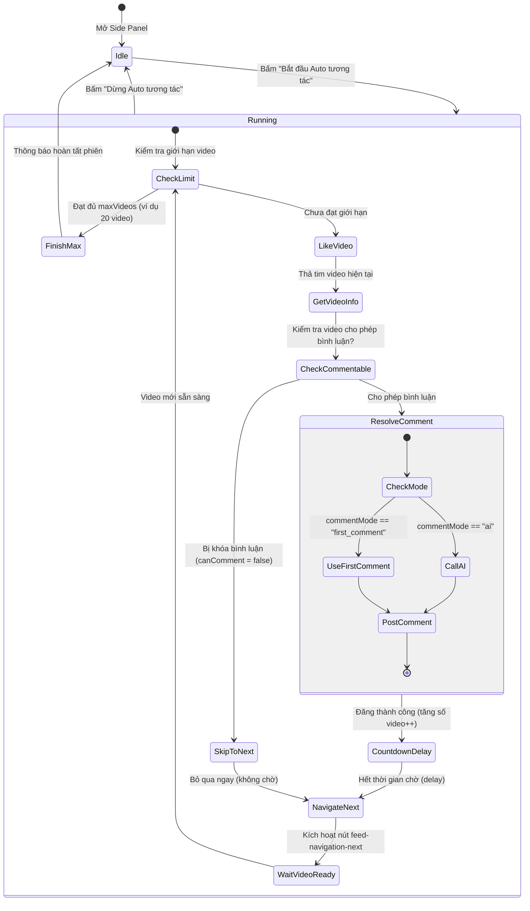

# Data Model & State Transitions: Auto Interaction & First Comment

## 1. Entities & Storage Schema

### Stored Settings Entity (`chrome.storage.local`)

| Thuộc tính | Kiểu dữ liệu | Giá trị mặc định | Mô tả |
| :--- | :--- | :--- | :--- |
| `likeMethod` | `string` | `"auto"` | Phương thức thả tim (`auto`, `button`, `key_l`, `double_click`) |
| `geminiApiKey` | `string` | `""` | Khóa API Gemini |
| `commentStyle` | `string` | `"friendly"` | Phong cách bình luận AI |
| `autoSubmit` | `boolean` | `true` | Tự động nhấn gửi bình luận |
| `commentMode` | `string` (`"ai"` \| `"first_comment"`) | `"ai"` | Chế độ nguồn bình luận (AI hoặc Bình luận đầu tiên) |
| `autoInteractDelay`| `number` | `5` | Thời gian chờ (giây) giữa các video trong chu trình Auto |
| `maxVideos` | `number` | `0` | Giới hạn số video trong phiên (0 là không giới hạn) |

---

### Video Metadata Entity (`GET_ACTIVE_VIDEO_INFO` Response Additions)

| Thuộc tính | Kiểu dữ liệu | Bắt buộc | Mô tả |
| :--- | :--- | :--- | :--- |
| `firstComment` | `string` \| `null` | Có | Nội dung bình luận đầu tiên của người xem khác (loại trừ tác giả) |
| `existingComments`| `string[]` | Có | Toàn bộ danh sách bình luận người xem trích xuất được |
| `canComment` | `boolean` | Có | `true` nếu video mở tính năng bình luận |

---

## 2. State Machine: Chu trình Auto tương tác liên tục

