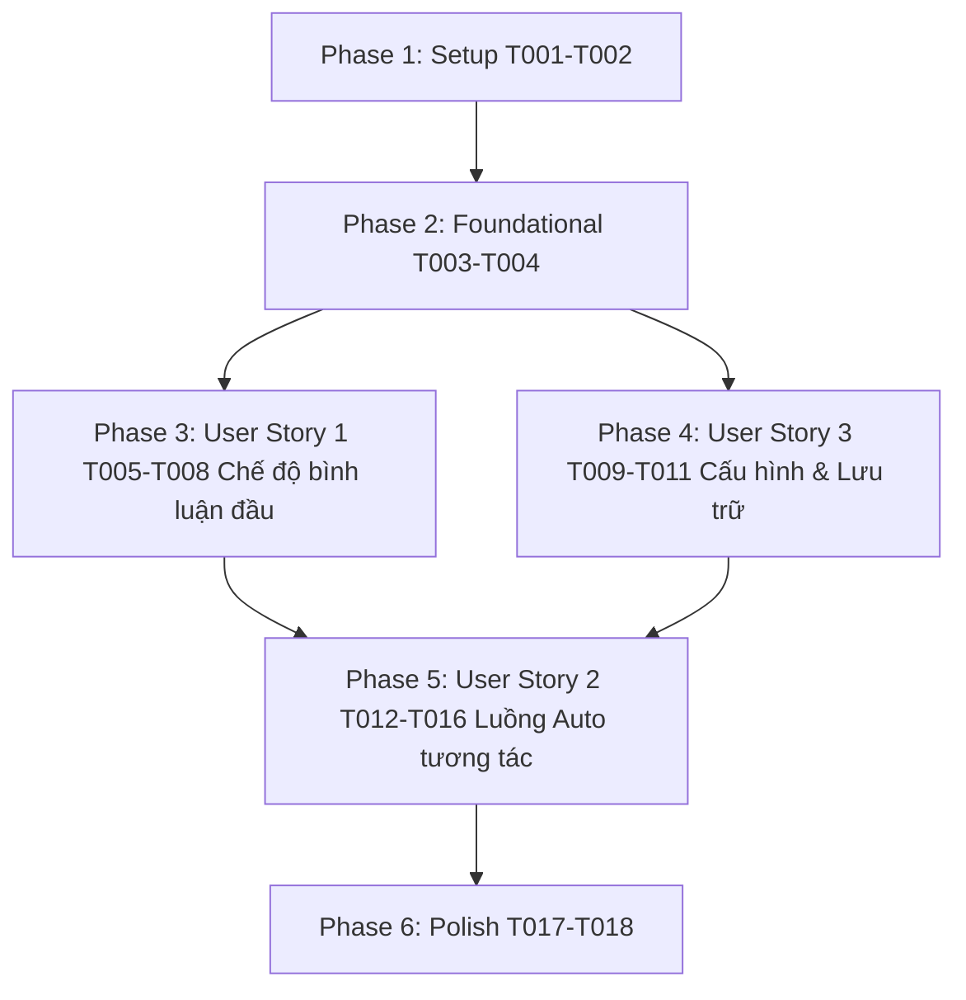

# Tasks: Tùy chọn bình luận đầu tiên & Tự động tương tác liên tục (Auto Interaction Flow)

**Input**: Design documents from `/specs/004-description-auto-interact/` (`spec.md`, `plan.md`, `research.md`, `data-model.md`, `contracts/messaging.md`, `quickstart.md`)

**Prerequisites**: plan.md (required), spec.md (required for user stories), research.md, data-model.md, contracts/

**Tests**: Kiểm thử thủ công theo các kịch bản xác thực định nghĩa tại [quickstart.md](./quickstart.md).

**Organization**: Tasks are grouped by user story to enable independent implementation and testing of each story.

## Format: `[TaskID] [P?] [Story?] Description with file path`

- **[P]**: Có thể thực hiện song song (khác tệp tin, không phụ thuộc vào task chưa hoàn thành)
- **[Story]**: Đánh dấu thuộc User Story nào ([US1], [US2], [US3])
- Luôn kèm đường dẫn tệp tin chính xác trong mô tả task

---

## Phase 1: Setup & Environment

**Purpose**: Đồng bộ phiên bản tiện ích và chuẩn bị cấu trúc tệp tin

- [x] T001 Cập nhật phiên bản tiện ích lên `1.4.0` trong [manifest.json](file:///d:/Code/extensions/auto-interaction-tiktok/manifest.json)
- [x] T002 Đồng bộ hằng số phiên bản `SCRIPT_VERSION = "1.4.0"` trong [content/content.js](file:///d:/Code/extensions/auto-interaction-tiktok/content/content.js) và [sidepanel/sidepanel.js](file:///d:/Code/extensions/auto-interaction-tiktok/sidepanel/sidepanel.js)

---

## Phase 2: Foundational (Blocking Prerequisites)

**Purpose**: Xây dựng các hằng số định danh và cơ chế chuyển video tiếp theo dùng chung cho cả US1 và US2

- [x] T003 [P] Bổ sung hằng số `SOURCE_FIRST_COMMENT = "first_comment"` và cập nhật nhãn `"💬 Bình luận đầu tiên:"` trong bảng `SOURCE_BADGES` trong [sidepanel/sidepanel.js](file:///d:/Code/extensions/auto-interaction-tiktok/sidepanel/sidepanel.js)
- [x] T004 [P] Xây dựng hàm `navigateNextVideo()` click `button[data-e2e="feed-navigation-next"]` (dự phòng phím `ArrowDown`) và đăng ký message handler `NAVIGATE_NEXT_VIDEO` trong [content/content.js](file:///d:/Code/extensions/auto-interaction-tiktok/content/content.js)

**Checkpoint**: Nền tảng điều hướng và hằng số đã sẵn sàng - có thể tiến hành triển khai các User Story.

---

## Phase 3: User Story 1 - Tùy chọn lấy bình luận đầu tiên của video (Priority: P1) 🎯 MVP 1

**Goal**: Cho phép người dùng tùy chọn bình luận bằng cách lấy chính xác bình luận cấp 1 đầu tiên của người xem khác trên video TikTok (bỏ qua bình luận của tác giả và bình luận ghim, ví dụ `"tui muốn đi nhầm cả đời"` trong `page.html`).

**Independent Test**: Mở video TikTok có bình luận, chọn chế độ "Lấy bình luận đầu tiên", bấm "Tự động bình luận". Xác nhận nội dung điền vào ô khớp với bình luận đầu tiên của người xem.

### Implementation for User Story 1

- [x] T005 [P] [US1] Bổ sung dropdown lựa chọn chế độ bình luận (`commentModeSelect`: `ai` hoặc `first_comment`) vào giao diện cài đặt trong [sidepanel/sidepanel.html](file:///d:/Code/extensions/auto-interaction-tiktok/sidepanel/sidepanel.html)
- [x] T006 [US1] Xây dựng hàm `extractFirstAudienceComment()` trong [content/content.js](file:///d:/Code/extensions/auto-interaction-tiktok/content/content.js) quét thẻ `span[data-e2e="comment-level-1"]` đầu tiên của người xem khác, tự động bỏ qua thẻ tác giả (`comment-creator-tag` / "Tác giả") và bình luận ghim ("Đã ghim")
- [x] T007 [US1] Mở rộng response của message handler `GET_ACTIVE_VIDEO_INFO` trong [content/content.js](file:///d:/Code/extensions/auto-interaction-tiktok/content/content.js) để trả về trường `firstComment: string | null`
- [x] T008 [US1] Cập nhật logic điều phối câu bình luận trong [sidepanel/sidepanel.js](file:///d:/Code/extensions/auto-interaction-tiktok/sidepanel/sidepanel.js): Khi `commentMode === "first_comment"`, ưu tiên lấy `videoInfo.firstComment` với nguồn `first_comment`; nếu không có, tự động fallback sang câu ngẫu nhiên

**Checkpoint**: Hoàn tất User Story 1. Chế độ bình luận đầu tiên hoạt động độc lập và chính xác.

---

## Phase 4: User Story 3 - Cấu hình thời gian chờ, giới hạn số video & Lưu trữ bền vững (Priority: P2)

**Goal**: Cung cấp giao diện chọn thời gian chờ (3s-15s), chọn giới hạn số lượng video trong phiên (10, 20, 50 hoặc Không giới hạn), và lưu bền vững toàn bộ cấu hình vào `chrome.storage.local`.

**Independent Test**: Thay đổi thời gian chờ thành 8s, chọn giới hạn 20 video, chọn chế độ "Bình luận đầu tiên", đóng Side Panel rồi mở lại để xác nhận 100% các giá trị vẫn được giữ nguyên.

### Implementation for User Story 3

- [x] T009 [P] [US3] Bổ sung dropdown thời gian chờ (`delaySelect`: 3s, 5s, 8s, 10s, 15s) và dropdown giới hạn video (`maxVideosSelect`: 0, 10, 20, 50) trong [sidepanel/sidepanel.html](file:///d:/Code/extensions/auto-interaction-tiktok/sidepanel/sidepanel.html)
- [x] T010 [P] [US3] Bổ sung kiểu dáng CSS cho section Auto tương tác, dropdown delay và max videos trong [sidepanel/sidepanel.css](file:///d:/Code/extensions/auto-interaction-tiktok/sidepanel/sidepanel.css)
- [x] T011 [US3] Nâng cấp hàm `loadSettings()` và `saveSettings()` trong [sidepanel/sidepanel.js](file:///d:/Code/extensions/auto-interaction-tiktok/sidepanel/sidepanel.js) để đọc, lưu và tự động cập nhật cả 3 trường mới (`commentMode`, `autoInteractDelay`, `maxVideos`)

**Checkpoint**: Toàn bộ cấu hình mới đã được kết nối với bộ nhớ bền vững `chrome.storage.local`.

---

## Phase 5: User Story 2 - Luồng tự động tương tác liên tục nhiều video (Priority: P1) 🎯 MVP 2

**Goal**: Bấm nút "Auto tương tác" một lần để tự động chạy chu trình: Thả tim -> Bình luận -> Đếm ngược chờ -> Bấm nút mũi tên xuống chuyển video tiếp theo -> Lặp lại. Tự động bỏ qua ngay khi video tắt bình luận và có nút Dừng khẩn cấp tức thì.

**Independent Test**: Bấm "Bắt đầu Auto tương tác", quan sát tiện ích tự thả tim, bình luận, đếm lùi thời gian, chuyển video và lặp lại. Bấm "Dừng lại" và xác nhận dừng ngay lập tức.

### Implementation for User Story 2

- [x] T012 [P] [US2] Bổ sung nút điều khiển chính `btnToggleAutoFlow` ("▶ Bắt đầu Auto tương tác") và khối nhãn tiến độ `autoFlowProgress` vào [sidepanel/sidepanel.html](file:///d:/Code/extensions/auto-interaction-tiktok/sidepanel/sidepanel.html)
- [x] T013 [P] [US2] Bổ sung kiểu dáng CSS cho nút `btn-auto-flow` (gradient tím nổi bật, hiệu ứng pulse khi đang chạy, trạng thái nút Dừng đỏ) trong [sidepanel/sidepanel.css](file:///d:/Code/extensions/auto-interaction-tiktok/sidepanel/sidepanel.css)
- [x] T014 [US2] Xây dựng hàm `interruptibleSleep(seconds, onTick)` trong [sidepanel/sidepanel.js](file:///d:/Code/extensions/auto-interaction-tiktok/sidepanel/sidepanel.js) đếm ngược từng giây và thoát ngay lập tức khi cờ `isAutoFlowRunning` chuyển thành `false`
- [x] T015 [US2] Xây dựng hàm `runAutoInteractionLoop()` trong [sidepanel/sidepanel.js](file:///d:/Code/extensions/auto-interaction-tiktok/sidepanel/sidepanel.js) thực hiện chu trình: Thả tim -> Bình luận -> Đếm ngược chờ -> Gửi message `NAVIGATE_NEXT_VIDEO` -> Lặp lại cho đến khi người dùng bấm Dừng hoặc đạt đủ `maxVideos`
- [x] T016 [US2] Tích hợp cơ chế bỏ qua tức thì khi video bị tắt tính năng bình luận (`canComment === false`) và gắn sự kiện click cho `btnToggleAutoFlow` để Bắt đầu / Dừng an toàn trong [sidepanel/sidepanel.js](file:///d:/Code/extensions/auto-interaction-tiktok/sidepanel/sidepanel.js)

**Checkpoint**: Hoàn tất User Story 2. Luồng Auto tương tác liên tục hoạt động mượt mà và an toàn.

---

## Phase 6: Polish & Cross-Cutting Concerns

**Purpose**: Tinh chỉnh trải nghiệm người dùng và xác thực toàn bộ hệ thống

- [x] T017 [P] Cập nhật tài liệu hướng dẫn sử dụng trong [README.md](file:///d:/Code/extensions/auto-interaction-tiktok/README.md) mô tả chế độ bình luận đầu tiên và nút Auto tương tác liên tục
- [x] T018 Thực hiện kiểm thử toàn diện cả 3 kịch bản theo [quickstart.md](./quickstart.md) trên trình duyệt Chrome

---

## Dependencies & Execution Order

### Song song hóa (Parallel Opportunities)
- **T003 & T004**: Thực hiện song song giữa `sidepanel.js` và `content.js`.
- **T005 & T006**: Giao diện HTML và thuật toán quét DOM trong content script có thể làm song song.
- **T009, T010**: Giao diện và kiểu dáng CSS cấu hình Auto tương tác có thể làm song song.
- **T012, T013**: Giao diện và CSS cho nút Bắt đầu / Dừng Auto có thể làm song song.

---

## Implementation Strategy

### MVP First
1. **MVP 1 (Chế độ bình luận đầu tiên)**: Hoàn thành Phase 1, Phase 2, Phase 3 -> Kiểm thử bấm bình luận đơn lẻ lấy đúng bình luận đầu của người xem.
2. **Cấu hình & Lưu trữ**: Hoàn thành Phase 4 -> Đảm bảo các tùy chọn delay và max videos được lưu trữ bền vững.
3. **MVP 2 (Luồng Auto tương tác)**: Hoàn thành Phase 5 -> Tự động hóa toàn bộ chu trình thả tim, bình luận, đếm ngược, chuyển video tiếp theo.
4. **Nghiệm thu**: Hoàn thành Phase 6 -> Cập nhật README và kiểm thử thực tế trên Chrome.

