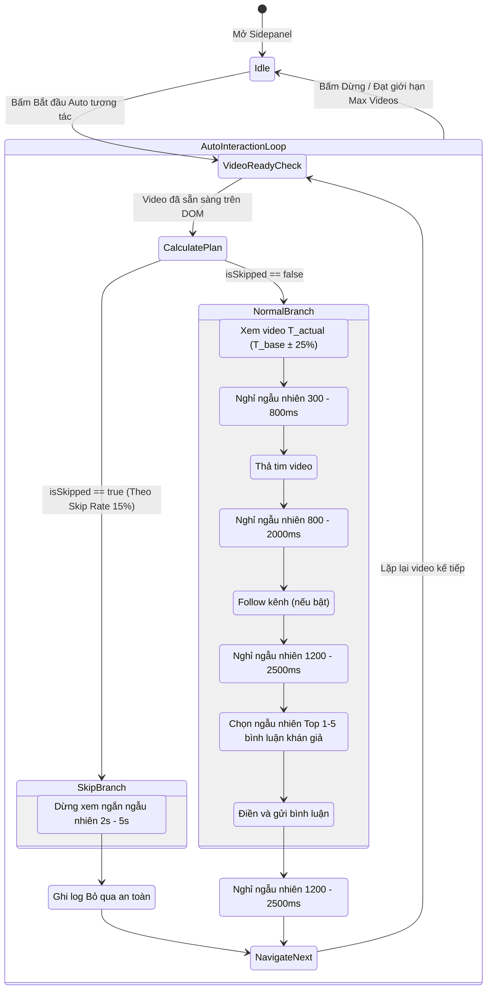

# Data Model: Anti-Bot & Tool Detection Humanizer

**Feature**: `005-anti-bot-humanizer`  
**Date**: 2026-11-05  
**Spec Reference**: [spec.md](./spec.md)

---

## 1. Storage Schema (`chrome.storage.local`)

Mở rộng cấu trúc lưu trữ hiện tại với các khóa cấu hình chống quét bot:

```typescript
interface ExtensionStorageSchema {
  // Existing settings (Feature 001 - 004)
  likeMethod: 'auto' | 'button' | 'key_l' | 'double_click';
  geminiApiKey: string;
  commentStyle: 'friendly' | 'compliment' | 'humorous' | 'question';
  autoSubmit: boolean;
  commentMode: 'ai' | 'first_comment';
  autoInteractDelay: number;      // Mốc thời gian cơ sở: 3, 5, 8, 10, 15
  maxVideos: number;              // Giới hạn: 0, 10, 20, 50
  autoFollow: boolean;            // Tự động follow kênh: true | false

  // NEW settings for Feature 005 (Anti-Bot Humanizer)
  humanizerEnabled: boolean;      // Công tắc tổng chống bot (Mặc định: true)
  jitterEnabled: boolean;         // Bật dao động ngẫu nhiên thời gian xem (Mặc định: true)
  jitterPercent: number;          // Tỷ lệ dao động: 25 (tương đương ±25%)
  skipRate: number;               // Tỷ lệ bỏ qua video: 0, 10, 15, 20, 30 (Mặc định: 15)
  commentDiversity: boolean;      // Chọn ngẫu nhiên trong top 3-5 bình luận (Mặc định: true)
}
```

### Giá trị mặc định (Defaults)
```javascript
const HUMANIZER_DEFAULTS = {
  humanizerEnabled: true,
  jitterEnabled: true,
  jitterPercent: 25,
  skipRate: 15,
  commentDiversity: true
};
```

---

## 2. Interaction Session Runtime State

Trạng thái thời gian chạy quản lý kế hoạch thực thi từng video:

```typescript
interface VideoInteractionPlan {
  videoIndex: number;
  totalVideos: number;
  isSkipped: boolean;             // Video này có bị bỏ qua theo Skip Rate không?
  skipWatchTimeSec: number;       // Thời gian dừng ngắn nếu bị skip: 2.0s - 5.0s
  baseDelaySec: number;           // Mốc thời gian cơ sở cài đặt
  actualWatchTimeSec: number;     // Thời gian xem thực tế sau khi tính Jitter
  microDelays: {
    beforeLikeMs: number;         // 300ms - 800ms
    beforeFollowMs: number;       // 800ms - 2000ms
    beforeCommentMs: number;      // 1200ms - 2500ms
    afterCommentMs: number;       // 1200ms - 2500ms
  };
}
```

---

## 3. Video Candidate Comments Entity

Cấu trúc danh sách bình luận được trích xuất từ DOM trang TikTok:

```typescript
interface ExtractedAudienceComments {
  rawCount: number;               // Tổng số bình luận quét được trong DOM
  candidates: string[];           // Danh sách top 1 - 5 bình luận hợp lệ của khán giả
  selectedIndex: number;          // Vị trí bình luận được chọn ngẫu nhiên
  selectedText: string;           // Nội dung bình luận được đưa vào soạn thảo
  source: 'first_comment';
}
```

---

## 4. State Machine: Vòng lặp Tự động có Chống Bot



