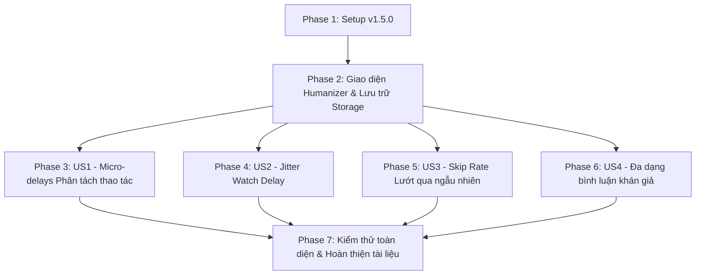

# Tasks: Anti-Bot & Tool Detection Humanizer

**Input**: Design documents from `/specs/005-anti-bot-humanizer/` (`spec.md`, `plan.md`, `research.md`, `data-model.md`, `contracts/messaging.md`, `quickstart.md`)

**Prerequisites**: plan.md (required), spec.md (required for user stories), research.md, data-model.md, contracts/

**Tests**: Kiểm thử thủ công theo các kịch bản định nghĩa tại [quickstart.md](./quickstart.md).

**Organization**: Tasks are grouped by user story to enable independent implementation and testing of each story.

## Format: `[TaskID] [P?] [Story?] Description with file path`

- **[P]**: Có thể thực hiện song song (khác tệp tin, không phụ thuộc vào task chưa hoàn thành)
- **[Story]**: Đánh dấu thuộc User Story nào ([US1], [US2], [US3], [US4])
- Luôn kèm đường dẫn tệp tin chính xác trong mô tả task

---

## Phase 1: Setup & Environment

**Purpose**: Đồng bộ phiên bản tiện ích và chuẩn bị cấu trúc tệp tin

- [x] T001 Cập nhật phiên bản tiện ích lên `1.5.0` trong [manifest.json](file:///d:/Code/extensions/auto-interaction-tiktok/manifest.json)
- [x] T002 Đồng bộ hằng số phiên bản `SCRIPT_VERSION = "1.5.0"` trong [content/content.js](file:///d:/Code/extensions/auto-interaction-tiktok/content/content.js) và [sidepanel/sidepanel.js](file:///d:/Code/extensions/auto-interaction-tiktok/sidepanel/sidepanel.js)
- [x] T003 Cập nhật nhãn phiên bản tại footer giao diện lên `v1.5.0` trong [sidepanel/sidepanel.html](file:///d:/Code/extensions/auto-interaction-tiktok/sidepanel/sidepanel.html)

---

## Phase 2: Foundational (Blocking Prerequisites)

**Purpose**: Xây dựng giao diện cài đặt Chống quét Bot, tích hợp lưu trữ `chrome.storage.local` và helper thời gian ngẫu nhiên

- [x] T004 [P] Bổ sung giao diện thẻ cấu hình Chống quét Bot (`#humanizerCard`) gồm công tắc tổng `humanizerEnabledCheck` và khối mở rộng accordion chứa các tùy chọn (`jitterCheck`, `skipRateSelect`, `commentDiversityCheck`) trong [sidepanel/sidepanel.html](file:///d:/Code/extensions/auto-interaction-tiktok/sidepanel/sidepanel.html)
- [x] T005 [P] Bổ sung kiểu dáng CSS cho thẻ Humanizer, switch toggle, badge bảo vệ và hiệu ứng đóng mở accordion trong [sidepanel/sidepanel.css](file:///d:/Code/extensions/auto-interaction-tiktok/sidepanel/sidepanel.css)
- [x] T006 Nâng cấp hàm `loadSettings()` và `saveSettings()` để đọc/ghi 5 trường cấu hình chống bot (`humanizerEnabled`, `jitterEnabled`, `jitterPercent`, `skipRate`, `commentDiversity`) trong [sidepanel/sidepanel.js](file:///d:/Code/extensions/auto-interaction-tiktok/sidepanel/sidepanel.js)
- [x] T007 Xây dựng các hàm tiện ích tính ngẫu nhiên: `getRandomInRange(min, max)`, `calculateJitterDelay(baseSec, jitterPercent)` và `shouldSkipVideo(skipRatePercent)` trong [sidepanel/sidepanel.js](file:///d:/Code/extensions/auto-interaction-tiktok/sidepanel/sidepanel.js)

**Checkpoint**: Nền tảng giao diện và lưu trữ cấu hình đã sẵn sàng cho cả 4 User Story.

---

## Phase 3: User Story 1 - Phân tách thời gian thao tác ngẫu nhiên (Priority: P1) 🎯 MVP 1

**Goal**: Loại bỏ việc thực hiện đồng loạt nhiều hành động; chèn micro-delays ngẫu nhiên (300ms - 2500ms) giữa Thả tim -> Follow -> Bình luận -> Chuyển video, hỗ trợ ngắt tức thì khi nhấn Dừng.

**Independent Test**: Kích hoạt Auto tương tác đủ Like, Follow, Comment; quan sát tiến trình: mỗi hành động cách nhau 1 khoảng nghỉ ngẫu nhiên, bấm Dừng thì phản hồi ngay dưới 150ms.

### Implementation for User Story 1

- [x] T008 [US1] Tích hợp micro-delay ngẫu nhiên `300ms - 800ms` trước khi Thả tim trong vòng lặp `runAutoInteractionLoop()` trong [sidepanel/sidepanel.js](file:///d:/Code/extensions/auto-interaction-tiktok/sidepanel/sidepanel.js)
- [x] T009 [US1] Tích hợp micro-delay ngẫu nhiên `800ms - 2000ms` trước khi Follow kênh trong [sidepanel/sidepanel.js](file:///d:/Code/extensions/auto-interaction-tiktok/sidepanel/sidepanel.js)
- [x] T010 [US1] Tích hợp micro-delay ngẫu nhiên `1200ms - 2500ms` trước khi gửi Bình luận trong [sidepanel/sidepanel.js](file:///d:/Code/extensions/auto-interaction-tiktok/sidepanel/sidepanel.js)
- [x] T011 [US1] Tích hợp micro-delay ngẫu nhiên `1200ms - 2500ms` sau khi Bình luận xong trước khi chuyển sang video kế tiếp trong [sidepanel/sidepanel.js](file:///d:/Code/extensions/auto-interaction-tiktok/sidepanel/sidepanel.js)
- [x] T012 [US1] Kiểm tra và đảm bảo tất cả các khoảng nghỉ micro-delay gọi qua `interruptibleSleepMs()` để hỗ trợ hủy bỏ ngay lập tức khi cờ `isAutoFlowRunning === false` trong [sidepanel/sidepanel.js](file:///d:/Code/extensions/auto-interaction-tiktok/sidepanel/sidepanel.js)

**Checkpoint**: Hoàn tất User Story 1. Toàn bộ các thao tác tương tác đã có khoảng nghỉ tự nhiên như người dùng thật.

---

## Phase 4: User Story 2 - Thời gian xem video ngẫu nhiên theo biên độ (Jitter Watch Delay) (Priority: P1) 🎯 MVP 2

**Goal**: Biến đổi thời gian xem mỗi video dao động ngẫu nhiên quanh mốc cơ sở ($T_{\text{base}} \pm 25\%$, sàn $\ge 3\text{s}$) thay vì một số giây cố định máy móc.

**Independent Test**: Đặt mốc thời gian xem là 10s và bật Jitter. Theo dõi 3 video liên tiếp thấy thời gian đếm ngược dao động tự nhiên (ví dụ 12s, 8s, 11s).

### Implementation for User Story 2

- [x] T013 [US2] Tích hợp hàm `calculateJitterDelay()` vào Bước 2 của vòng lặp `runAutoInteractionLoop()` để tính thời gian xem thực tế $T_{\text{actual}}$ cho từng video trong [sidepanel/sidepanel.js](file:///d:/Code/extensions/auto-interaction-tiktok/sidepanel/sidepanel.js)
- [x] T014 [US2] Cập nhật giao diện đếm ngược trên `statusBox` hiển thị số giây ngẫu nhiên thực tế đang đếm lùi kèm thông báo trạng thái dao động tự nhiên trong [sidepanel/sidepanel.js](file:///d:/Code/extensions/auto-interaction-tiktok/sidepanel/sidepanel.js)

**Checkpoint**: Hoàn tất User Story 2. Thời gian xem giữa các video không còn bị trùng lặp cơ học.

---

## Phase 5: User Story 3 - Tỷ lệ lướt qua ngẫu nhiên không tương tác (Natural Skip Rate) (Priority: P2)

**Goal**: Cung cấp tùy chọn tỷ lệ bỏ qua video (0% - 50%, mặc định 15%); khi rơi vào skip, bot chỉ xem ngắn 2s - 5s rồi lướt tiếp mà không thả tim, follow hay bình luận.

**Independent Test**: Đặt tỷ lệ Skip là 30%. Chạy qua 10 video, kiểm tra có khoảng 2 - 4 video hiển thị thông báo "🎲 Bỏ qua an toàn", chỉ dừng xem 2-5s rồi tự động next video.

### Implementation for User Story 3

- [x] T015 [US3] Tích hợp nhánh kiểm tra `shouldSkipVideo(skipRate)` vào đầu mỗi chu kỳ video trong `runAutoInteractionLoop()` trong [sidepanel/sidepanel.js](file:///d:/Code/extensions/auto-interaction-tiktok/sidepanel/sidepanel.js)
- [x] T016 [US3] Triển khai luồng Quick Watch khi video bị Skip: Hiển thị trạng thái `🎲 Bỏ qua tương tác`, dừng xem ngắn ngẫu nhiên từ 2s đến 5s bằng `interruptibleSleep()`, sau đó gửi lệnh `NAVIGATE_NEXT_VIDEO` mà không thực hiện like/follow/comment trong [sidepanel/sidepanel.js](file:///d:/Code/extensions/auto-interaction-tiktok/sidepanel/sidepanel.js)

**Checkpoint**: Hoàn tất User Story 3. Bot mô phỏng hoàn hảo hành vi người dùng lướt qua các video không hứng thú.

---

## Phase 6: User Story 4 - Đa dạng hóa lựa chọn bình luận khán giả (Diverse Comment Selection) (Priority: P2)

**Goal**: Thu thập top 3 - 5 bình luận hợp lệ của khán giả (loại trừ tác giả & ghim) và ngẫu nhiên chọn 1 câu thay vì luôn luôn sao chép bình luận đầu tiên.

**Independent Test**: Bật chế độ "Lấy ngẫu nhiên bình luận người xem" trên video có nhiều bình luận; xác nhận câu được chọn ngẫu nhiên trong danh sách top khán giả, không bị bó cứng vào câu đầu tiên.

### Implementation for User Story 4

- [x] T017 [US4] Xây dựng hàm `extractAudienceComments(container, limit = 5)` trong [content/content.js](file:///d:/Code/extensions/auto-interaction-tiktok/content/content.js) lọc danh sách top 3 - 5 bình luận hợp lệ của khán giả (loại bỏ tác giả, ghim, bình luận quá ngắn < 3 ký tự)
- [x] T018 [US4] Cập nhật hàm `waitForAudienceComments(container, maxWaitMs = 3000)` trong [content/content.js](file:///d:/Code/extensions/auto-interaction-tiktok/content/content.js) chờ động danh sách bình luận xuất hiện
- [x] T019 [US4] Mở rộng response của handler `GET_ACTIVE_VIDEO_INFO` trong [content/content.js](file:///d:/Code/extensions/auto-interaction-tiktok/content/content.js) trả về trường `audienceComments: string[]` song song với `firstComment`
- [x] T020 [US4] Cập nhật hàm `resolveCommentForVideo()` trong [sidepanel/sidepanel.js](file:///d:/Code/extensions/auto-interaction-tiktok/sidepanel/sidepanel.js): Khi `commentMode === "first_comment"` và `commentDiversity === true`, chọn ngẫu nhiên 1 câu trong danh sách `audienceComments` (ưu tiên top 3-5), hiển thị vị trí được chọn trên thông báo trạng thái

**Checkpoint**: Hoàn tất User Story 4. Loại bỏ hoàn toàn hiện tượng sao chép trùng lặp bình luận top 1.

---

## Phase 7: Polish & Cross-Cutting Concerns

**Purpose**: Tinh chỉnh trải nghiệm người dùng và xác thực toàn diện hệ thống

- [x] T021 [P] Cập nhật tài liệu hướng dẫn tại [README.md](file:///d:/Code/extensions/auto-interaction-tiktok/README.md) mô tả chi tiết tính năng Chống quét Bot (Jitter, Skip Rate, Micro-delays, Đa dạng bình luận)
- [x] T022 Thực hiện kiểm thử toàn diện cả 5 kịch bản theo [quickstart.md](./quickstart.md) trên trình duyệt Chrome

---

## Dependencies & Execution Order

---

## Implementation Strategy

### MVP First (Phát hành từng đợt an toàn)
1. **MVP 1 (Phase 1, 2, 3)**: Xây dựng nền tảng giao diện Humanizer và Phân tách thao tác (Micro-delays). Đảm bảo không còn bất kỳ hành động nào kích hoạt đồng thời.
2. **MVP 2 (Phase 4)**: Kích hoạt Jitter Watch Delay để thời gian xem mỗi video dao động ngẫu nhiên quanh mốc cơ sở.
3. **Mở rộng (Phase 5 & 6)**: Kích hoạt Skip Rate và Đa dạng hóa bình luận khán giả.
4. **Nghiệm thu (Phase 7)**: Kiểm thử toàn diện 5 kịch bản theo `quickstart.md`.

